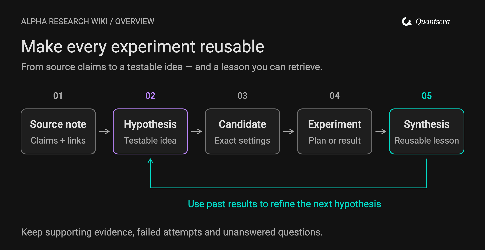

# Alpha Research Wiki

[คู่มือภาษาไทยพร้อมภาพ Flow](README.md) · English summary

A project-local research skill and Obsidian-compatible starter for
**WorldQuant BRAIN and Python/Qlib**. Share papers, source claims and economic
hypotheses in one wiki; keep each implementation and its results reproducible
with backend-specific settings.

**Version 0.2.0.** The installed identifier remains
`llm-wiki-alpha-brain-research` so existing BRAIN projects continue to work.

Paper / evidence → hypothesis → candidate → experiment → reusable lesson.

[](docs/assets/flow-overview.svg)

- Research a topic or paper, separate reported findings from proposed alpha
  translations, and define a falsifiable next experiment.
- Keep failed experiments, repair lineage and contradictory evidence.
- Compare BRAIN and Python/Qlib results with their actual universe, dates,
  timing, costs and test scope stated explicitly.
- Use seven note templates, evidence review and research-delta workflows.
- Validate record links, artifact hashes and exact tested snapshots locally.

The CLI manages research memory. Execution is supplied by your selected
BRAIN or Python/Qlib workflow; neither platform access nor a backtester is
required to use the wiki.

## Install and try

Requirements: Python 3.11 or later and PyYAML in the project virtual environment. From this repository:

```bash
python3 -m venv .venv
.venv/bin/python -m pip install -r requirements.txt
.venv/bin/python -m unittest discover -s tests -p 'test_*.py' -v
mkdir -p research
.venv/bin/python skills/llm-wiki-alpha-brain-research/scripts/brain_wiki.py init --wiki research/wiki
.venv/bin/python skills/llm-wiki-alpha-brain-research/scripts/brain_wiki.py lint --wiki research/wiki
```

Windows: use `.venv\Scripts\python.exe` in place of `.venv/bin/python`.
Additional offline CLI operations (capture stores bytes; typed research notes
are authored using the referenced contract):

```bash
.venv/bin/python skills/llm-wiki-alpha-brain-research/scripts/brain_wiki.py capture --wiki research/wiki --file README.md
.venv/bin/python skills/llm-wiki-alpha-brain-research/scripts/brain_wiki.py index --wiki research/wiki
.venv/bin/python skills/llm-wiki-alpha-brain-research/scripts/brain_wiki.py handoff --wiki research/wiki --output research/handoff
```

Replace the capture input with an accessible local source file. Open research/wiki as an Obsidian vault if desired. Obsidian is optional.
The synthetic example contains seven records across both backends and no
actual simulation or backtest result. It can be checked with:

```bash
.venv/bin/python skills/llm-wiki-alpha-brain-research/scripts/brain_wiki.py lint --wiki examples/synthetic
```

Install the entire skills/llm-wiki-alpha-brain-research directory in your
host's documented skill location, or explicitly provide its SKILL.md to the
host. Keep scripts, references and assets beside it. Installation discovery
varies by host; manual invocation is the portable fallback.

Example request:

```text
Use $llm-wiki-alpha-brain-research to research post-earnings drift in this
project. Share the evidence and hypothesis across BRAIN and Python/Qlib,
keep their candidates separate, and produce a predeclared test plan.
```

Other requests: “Capture this paper into the project wiki”, “Record this
failed Qlib run”, “Show what changed since our last review”, and “Find prior
failures before proposing another variant”. The host skill orchestrates
research; the CLI only initializes, captures local bytes, validates typed
records, rebuilds navigation and exports a manual handoff.

See the [backend contract](skills/llm-wiki-alpha-brain-research/references/backends.md),
[research playbook](skills/llm-wiki-alpha-brain-research/references/research-playbook.md)
and [invocation examples](skills/llm-wiki-alpha-brain-research/references/usage.md).

See the illustrated [shared-backend workflow](README.md#backends),
[learning loop](README.md#learning-loop) and [editable diagram sources](docs/diagrams/README.md).

New candidate/experiment notes explicitly declare `backend: brain` or
`backend: python`. Old records without a backend remain BRAIN records.
`live_brain` and `local_backtest` are distinct evidence kinds. The manual
BRAIN handoff excludes Python candidates. Use v0.2.0 or later for a mixed wiki;
older releases cannot write Python records.

## Evidence and privacy

Actual research lives under ignored research/ by default. Framework files
and synthetic examples are distributable; project sources/results are not
part of the package. Do not commit credentials or account exports. Gitignore
does not remove already tracked files; review the staged file list.

A clean lint result checks structure and provenance fields, not financial
validity. The package has no live BRAIN client, backtester, automatic alpha
submission, fixed platform thresholds, dashboard or web crawler. Existing
research tools can supply candidates and artifacts through the documented
handoff. Never infer current field access or program eligibility from examples.

## Development

This local MVP assumes a single writer; concurrent writes are unsupported.
The combined 66-test offline suite covers the original storage/provenance
guards and 21 new backend contract cases. Ten directed Codex cases were observed for
the earlier BRAIN-only version; the v0.2.0 research guidance has not received
a new independent model forward-test. Automatic discovery and Claude behavior
remain unverified.
See [verification](docs/verification.md) and [observed behavioral evidence](docs/behavioral-evidence.md)
for the tested scope and remaining limits.

Run the offline suite above. Run manual cases in tests/behavioral-cases.md
before advertising host support. The maintainer exports skill assets from
a private canonical source using scripts/export_skill.py; contributors edit
their checkout and submit a diff that is applied to the canonical source
before regeneration. No private vault path is required to use this package.

Read docs/provenance.md for architectural attribution. This project is an
independent implementation and is not affiliated with WorldQuant.

Code and documentation use the [MIT license](LICENSE). Bundled Roboto fonts
use the [SIL Open Font License](docs/assets/fonts/Roboto-OFL.txt). Quantsera
brand marks remain the property of their owner; the code license does not
grant trademark rights. See [visual asset provenance](docs/assets/README.md).
