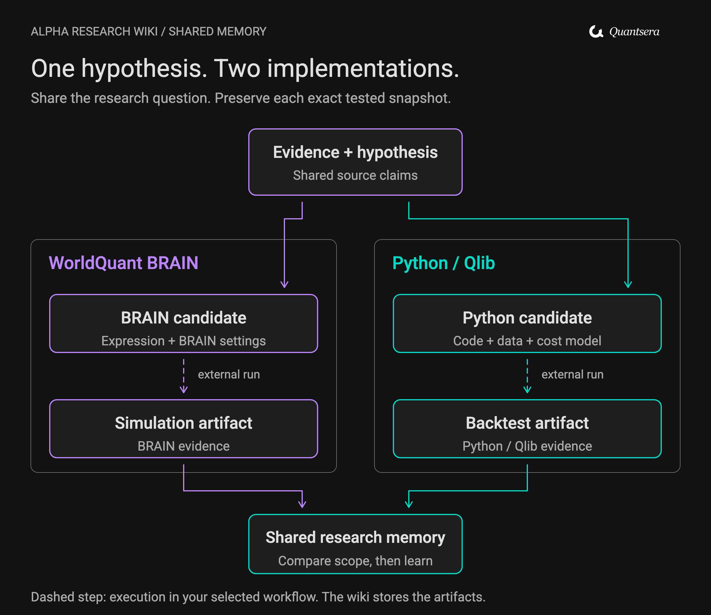
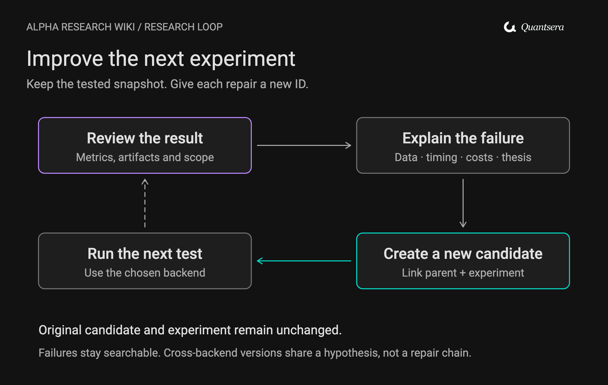

# Alpha Research Wiki

**เปลี่ยน Paper ไอเดีย และผลทดลอง ให้เป็นคลังวิจัยที่ค้นกลับมาใช้ต่อได้**

สกิลสำหรับทำ Alpha Research ด้วย **WorldQuant BRAIN และ Python/Qlib** โดยใช้คลังหลักฐานและสมมติฐานร่วมกัน เก็บสูตร โค้ด การตั้งค่า และผลทดลองของแต่ละฝั่งให้ตรวจย้อนกลับได้ ตั้งแต่คำถามแรกจนถึงบทเรียนที่ใช้วางแผนทดลองรอบถัดไป

[](https://github.com/nutdnuy/llm-wiki-alpha-brain-research/actions/workflows/test.yml)
[](LICENSE)

**Version 0.2.0** · [English summary](README.en.md) · [เปิดตัวสกิล](skills/llm-wiki-alpha-brain-research/SKILL.md) · [ดูตัวอย่าง Wiki](examples/synthetic/05-Index/Home.md)

[ภาพรวม](#overview) · [สิ่งที่จะได้](#outputs) · [BRAIN + Python/Qlib](#backends) · [เริ่มใช้งาน](#quickstart) · [ตัวอย่างคำสั่ง](#prompts) · [วงจรเรียนรู้](#learning-loop) · [โครงสร้าง](#structure) · [ตรวจคุณภาพ](#quality)

<a id="overview"></a>
## จากการอ่าน Paper สู่การทดลองที่มีที่มา

[](docs/assets/flow-overview.svg)

อ่านจากซ้ายไปขวา: **หลักฐาน → สมมติฐาน → วิธีทดสอบ → ผลทดลอง → บทเรียน** ลูกศรย้อนกลับคือการนำสิ่งที่เรียนรู้ไปปรับคำถามรอบถัดไป คลิกภาพเพื่อขยาย

ปัญหาที่พบได้บ่อยคือ อ่านงานวิจัยไว้ในที่หนึ่ง คิดสูตรในแชตอีกที่ แล้วเก็บผล Backtest แยกออกไป เมื่อต้องกลับมาทำต่อ เราจึงต้องไล่หาว่าสูตรนี้มาจากอะไร เคยลองแบบไหน และเหตุใดจึงเลิกทำ

Alpha Research Wiki เชื่อมสิ่งเหล่านี้ด้วยไฟล์ Markdown และ ID ที่อ้างอิงถึงกัน โดยเก็บทั้งผลที่น่าสนใจ ผลที่ล้มเหลว และข้อสงสัยที่ยังไม่มีคำตอบ ใช้กับโฟลเดอร์โปรเจกต์ทั่วไปหรือเปิดใน Obsidian ก็ได้

> **ขอบเขตของเครื่องมือ:** สกิลช่วยจัดกระบวนการวิจัย และ CLI จัดเก็บกับตรวจโครงสร้างข้อมูล การรัน Simulation หรือ Backtest ใช้ workflow ภายนอกของ BRAIN หรือ Python/Qlib แล้วนำหลักฐานผลลัพธ์กลับเข้ามาใน Wiki

<a id="outputs"></a>
## ทำหนึ่งรอบแล้วได้อะไร

คลังวิจัยแบ่งเป็นโน้ต 5 ประเภท พร้อม Template 7 ไฟล์ เพราะ Candidate และ Experiment แยกตาม backend

| โน้ต | คำถามที่ตอบ | สิ่งที่เก็บ |
| --- | --- | --- |
| **Source** | ต้นทางบอกอะไรไว้จริง | ข้อค้นพบ ตำแหน่งอ้างอิง และไฟล์หลักฐาน |
| **Hypothesis** | เหตุใดจึงคาดว่าจะเกิดผล | กลไก ทิศทางที่คาด ช่วงเวลา และเงื่อนไขหักล้าง |
| **Candidate** | จะทดสอบแนวคิดนี้อย่างไร | สูตรหรือ Code entrypoint พร้อม Settings ของ backend |
| **Experiment** | ทดสอบอะไรไปแล้ว และได้อะไร | Snapshot ที่ทดสอบจริง ขอบเขต Metrics และ Artifacts |
| **Synthesis** | รอบต่อไปควรเรียนรู้อะไรจากผลเหล่านี้ | ข้อสรุป หลักฐานที่ขัดแย้ง และสิ่งที่ควรตรวจต่อ |

[เปิด Template ทั้งหมด](skills/llm-wiki-alpha-brain-research/assets/starter/04-Schema/Templates) · [อ่านสัญญาข้อมูล](skills/llm-wiki-alpha-brain-research/references/data-contract.md)

เริ่มจากหัวข้อหรือ Paper ก็ได้ หากยังไม่รู้ข้อมูลที่ต้องใช้ สกิลจะเก็บช่องว่างนั้นไว้ในโจทย์วิจัย ก่อนสร้าง Candidate ที่ต้องมี Settings ครบถ้วน

<a id="backends"></a>
## BRAIN และ Python/Qlib ใช้ความรู้ชุดเดียวกัน

[](docs/assets/flow-two-backends.svg)

**Source และ Hypothesis ใช้ร่วมกัน ส่วน Candidate และ Experiment มี ID ของตัวเอง** เส้นประในภาพคือขั้นตอนรันด้วยเครื่องมือภายนอก ผลจากทั้งสองฝั่งกลับมาเป็นหลักฐานให้สังเคราะห์ร่วมกันได้

| ประเด็น | WorldQuant BRAIN | Python / Qlib |
| --- | --- | --- |
| สิ่งที่นำไปทดสอบ | Expression และ Platform settings | สูตรหรือ Code entrypoint พร้อม Runner configuration |
| สิ่งที่ต้องระบุ | เช่น Region, Universe, Delay, Neutralization | เช่น Code revision, Data snapshot, Lags, Portfolio และ Costs |
| ประเภทหลักฐานผลจริง | `live_brain` | `local_backtest` |
| การส่งงานต่อ | CLI ส่งออก Manual BRAIN handoff | ใช้ Config และ Runner ของโปรเจกต์ แล้วนำผลกลับมา Capture |

ก่อนเทียบผล ต้องอ่าน Universe, ช่วงเวลา, จังหวะซื้อขาย, ต้นทุน และขอบเขตทดสอบของทั้งคู่ การใช้สมมติฐานเดียวกันไม่ได้ทำให้ตัวเลขสองชุดเทียบตรงกันได้เสมอ

ดูรายละเอียดใน [Backend contract](skills/llm-wiki-alpha-brain-research/references/backends.md) โน้ตใหม่ระบุ `backend: brain` หรือ `backend: python` ชัดเจน ส่วนโน้ตรุ่นเดิมที่ไม่มี backend ยังถือเป็น BRAIN เพื่อรองรับงานเก่า

<a id="quickstart"></a>
## เริ่มใช้งาน

### 1. เตรียมโปรเจกต์

ใช้ **Python 3.11 ขึ้นไป** และ Git คำสั่งต่อไปนี้ใช้บน macOS/Linux:

```bash
git clone https://github.com/nutdnuy/llm-wiki-alpha-brain-research.git
cd llm-wiki-alpha-brain-research
python3 -m venv .venv
.venv/bin/python -m pip install -r requirements.txt
```

บน Windows ใช้ `.venv\Scripts\python.exe` แทน `.venv/bin/python` และใช้คำสั่งสร้างโฟลเดอร์ของ Shell ที่ใช้อยู่

### 2. สร้าง Wiki แรก

```bash
mkdir -p research
.venv/bin/python skills/llm-wiki-alpha-brain-research/scripts/brain_wiki.py init --wiki research/wiki
.venv/bin/python skills/llm-wiki-alpha-brain-research/scripts/brain_wiki.py lint --wiki research/wiki
```

เปิด `research/wiki/05-Index/Home.md` เพื่อเริ่มอ่าน หรือเปิดโฟลเดอร์ `research/wiki` เป็น Vault ใน Obsidian ก็ได้ **ไม่จำเป็นต้องติดตั้ง Obsidian หรือเชื่อมบัญชี BRAIN เพื่อเริ่มใช้คลังวิจัย**

`init` ใช้กับตำแหน่งใหม่เท่านั้น หากมี Wiki อยู่แล้วให้ใช้โฟลเดอร์นั้นต่อ หรือเลือกชื่อใหม่

### 3. ให้ AI อ่านสกิล

เปิด [SKILL.md](skills/llm-wiki-alpha-brain-research/SKILL.md) ให้ AI host ที่ใช้เข้าถึงได้ หรือคัดลอกทั้งโฟลเดอร์ `skills/llm-wiki-alpha-brain-research` ไปยังตำแหน่งติดตั้งสกิลตามคู่มือของ host นั้น เก็บ `scripts/`, `references/` และ `assets/` ไว้ด้วยกัน

ชื่อสำหรับเรียกใช้งานยังเป็น **`llm-wiki-alpha-brain-research`** เพื่อให้โปรเจกต์ BRAIN เดิมใช้งานต่อได้ ตัวอย่างคำขอ:

```text
ใช้ $llm-wiki-alpha-brain-research ศึกษา post-earnings drift ในโปรเจกต์นี้
ใช้ research/wiki เป็นคลังร่วมสำหรับ BRAIN และ Python/Qlib

เริ่มจากหลักฐานและกลไก ตั้งสมมติฐานที่หักล้างได้
แยก Candidate ของแต่ละ backend และจัดทำแผนทดสอบก่อนรัน
หากข้อมูลหรือ Settings ยังไม่ครบ ให้บอกสิ่งที่ขาดไว้ชัดเจน
```

หาก host ไม่รู้จักชื่อสกิล ให้ระบุพาธ `SKILL.md` โดยตรง การค้นพบสกิลอัตโนมัติขึ้นกับ host และการติดตั้ง

### อยากดูตัวอย่างก่อน

เปิด [Synthetic Wiki](examples/synthetic/05-Index/Home.md) ซึ่งมี 7 Records ครอบคลุมทั้งสอง backend แล้วลองตรวจด้วย:

```bash
.venv/bin/python skills/llm-wiki-alpha-brain-research/scripts/brain_wiki.py lint --wiki examples/synthetic
```

ตัวอย่างนี้สาธิตรูปแบบข้อมูล ใช้ค่าจำลองและสถานะ `untested` ยังไม่มีผล Simulation หรือ Backtest จริง

<a id="prompts"></a>
## สั่งงานเป็นภาษาธรรมชาติ

ใช้ข้อความเหล่านี้ต่อจากการเรียกสกิล โดยระบุโปรเจกต์หรือ Wiki ให้ชัดเจน

| ต้องการทำอะไร | ตัวอย่างคำขอ |
| --- | --- |
| เริ่มจาก Paper | “นำ Paper นี้เข้าคลัง แยกข้อค้นพบของผู้เขียนออกจากไอเดีย Alpha ที่เราตีความต่อ” |
| เริ่มจากคำถาม | “ศึกษาว่าผลตอบสนองต่อข่าวล่าช้าเกิดจากกลไกใด หาเงื่อนไขที่ทำให้สมมติฐานนี้ผิดได้” |
| ทำสอง backend | “ใช้ Hypothesis นี้สร้าง Candidate สำหรับ BRAIN และ Python/Qlib โดยอ้างถึงหลักฐานร่วมกัน” |
| บันทึกผลทดลอง | “นำ Artifact ของ Qlib run นี้เข้าคลัง เก็บ Settings ที่รันจริง และเชื่อมกลับไปยัง Candidate” |
| ย้อนดูสิ่งที่ล้มเหลว | “ก่อนเสนอสูตรใหม่ หา Experiment ที่เคยล้มเหลวในกลุ่มนี้ แล้วอธิบายว่ารอบใหม่ต่างจากเดิมตรงไหน” |
| เปรียบเทียบหลักฐาน | “เทียบผล BRAIN กับ Python ของสมมติฐานนี้ ระบุความต่างของข้อมูล ช่วงเวลา และ Costs” |
| ทบทวนสิ่งที่เปลี่ยน | “สรุปว่าหลักฐานอะไรเพิ่มขึ้นหรือขัดแย้งกับครั้งก่อน พร้อมอ้างถึงโน้ตต้นทาง” |
| ตรวจคลัง | “ตรวจสุขภาพ Wiki แบบอ่านอย่างเดียว แยกปัญหาโครงสร้างออกจากสิ่งที่ต้องทบทวนเชิงวิจัย” |

รายการนี้เป็นเส้นทางทำงานของสกิล CLI ที่มาพร้อมแพ็กเกจมีเฉพาะ `init`, `capture`, `lint`, `index` และ `handoff` ดู [ตัวอย่างเพิ่มเติม](skills/llm-wiki-alpha-brain-research/references/usage.md)

<a id="learning-loop"></a>
## ผลที่ไม่ผ่านก็ช่วยให้งานรอบถัดไปดีขึ้นได้

[](docs/assets/flow-learning-loop.svg)

1. **อ่านผลตามขอบเขตที่รันจริง** — ตรวจ Metrics, Artifacts และส่วนที่ยังไม่ได้ทดสอบ
2. **ตั้งข้ออธิบายที่ตรวจต่อได้** — ปัญหาอยู่ที่ข้อมูล เวลา ต้นทุน หรือกลไกที่ตั้งไว้
3. **สร้าง Candidate ใหม่** — บันทึกสิ่งที่เปลี่ยน เชื่อม `parent_candidate` และ `repair_experiment`
4. **ทดลองตามแผนรอบใหม่** — เมื่อรันเสร็จจึงนำ Artifact กลับมาเชื่อมเป็น Experiment ใหม่

เก็บ Candidate และ Experiment ที่เคยทดสอบไว้ตามเดิม จึงย้อนดูได้ว่าข้อสรุปเกิดจากเวอร์ชันไหน สายการแก้ไขอยู่ภายใน backend เดียวกัน ส่วนเวอร์ชันข้าม backend เชื่อมกันผ่าน Hypothesis และคำอธิบายในโน้ต

อ่าน [Research playbook](skills/llm-wiki-alpha-brain-research/references/research-playbook.md) และ [Review / research delta](skills/llm-wiki-alpha-brain-research/references/review-and-delta.md)

<a id="structure"></a>
## โครงสร้างคลังวิจัย

เมื่อสร้าง Wiki ในโปรเจกต์ จะได้โครงหลักดังนี้:

```text
research/wiki/
├── AGENTS.md                  # กติกาการอ่านและเขียน Wiki
├── 01-Raw/                    # สำเนาหลักฐาน ใช้ชื่อไฟล์ตาม SHA-256
├── 02-Wiki/
│   ├── Sources/               # ข้อค้นพบจากต้นทาง
│   ├── Hypotheses/            # สมมติฐานร่วม
│   ├── Candidates/            # วิธีทดสอบ แยก backend
│   ├── Experiments/           # แผนและผล พร้อม Snapshot
│   └── Syntheses/             # บทเรียนจากหลายหลักฐาน
├── 03-Logs/Log.md             # ประวัติการทำงานและการตรวจ
├── 04-Schema/
│   ├── Contract.md            # ข้อกำหนดข้อมูล
│   └── Templates/             # Template ทั้ง 7 แบบ
└── 05-Index/                  # หน้าเริ่มต้นและสารบัญวิจัย
```

ส่วน Repo นี้เก็บตัวสกิลใน [`skills/`](skills/llm-wiki-alpha-brain-research) ตัวอย่างใน [`examples/`](examples/synthetic) และเอกสารใน [`docs/`](docs) โฟลเดอร์ `research/` ถูก Ignore เพื่อแยกงานวิจัยจริงของแต่ละโปรเจกต์ออกจากแพ็กเกจ

<details>
<summary><strong>คำสั่ง CLI เพิ่มเติม: Capture, Index และ BRAIN handoff</strong></summary>

รันจากราก Repo หลังสร้าง Wiki แล้ว:

```bash
# ตัวอย่างเก็บสำเนาไฟล์ในเครื่อง เปลี่ยน README.md เป็นไฟล์ต้นทางที่ต้องการ
.venv/bin/python skills/llm-wiki-alpha-brain-research/scripts/brain_wiki.py capture --wiki research/wiki --file README.md

# ตรวจโครงสร้างก่อนสร้างสารบัญใหม่
.venv/bin/python skills/llm-wiki-alpha-brain-research/scripts/brain_wiki.py lint --wiki research/wiki
.venv/bin/python skills/llm-wiki-alpha-brain-research/scripts/brain_wiki.py index --wiki research/wiki

# ส่งออกงาน BRAIN ไปยังโฟลเดอร์ใหม่สำหรับส่งต่อด้วยตนเอง
.venv/bin/python skills/llm-wiki-alpha-brain-research/scripts/brain_wiki.py handoff --wiki research/wiki --output research/handoff
```

`capture` เก็บ Bytes และ Hash ของไฟล์ในเครื่อง การอ่านเนื้อหาและเขียน Source Note เป็นขั้นตอนถัดไปของสกิล คำสั่งนี้ไม่ได้ดึง URL หรือแปลง PDF เป็นข้อความเอง

`handoff` ส่งออกเฉพาะ Candidate ของ BRAIN ที่ผ่านเงื่อนไขสำหรับส่งต่อ และไม่เรียก Simulation ให้อัตโนมัติ รายละเอียดอยู่ใน [Manual BRAIN handoff](skills/llm-wiki-alpha-brain-research/references/brain-handoff.md)

</details>

<a id="quality"></a>
## ตรวจอะไรได้ และอะไรยังต้องทบทวน

| ชั้นของการตรวจ | สิ่งที่ตรวจ |
| --- | --- |
| **โครงสร้าง** | Fields, ID, ความเชื่อมโยงของ Records, Hash ของ Artifacts และ Snapshot ที่ทดสอบ |
| **หลักฐาน** | ข้ออ้างตรงกับต้นทางหรือไม่ มีตำแหน่งอ้างอิงและข้อขัดแย้งใด ผู้ทบทวนอีกคนต้องตรวจก่อนเปลี่ยนเป็น `reviewed` |
| **ผลวิจัย** | ขอบเขตทดสอบ ข้อมูลรั่ว ต้นทุน และเงื่อนไขที่กำหนดไว้ในแผนวิจัยหรือ Platform policy ที่เกี่ยวข้อง |

**Lint ผ่านหมายถึงโครงสร้างผ่านการตรวจ** ยังต้องอ่านหลักฐานและประเมินผลวิจัยแยกกัน `offline_proxy` ใช้เป็นแนวทางทดสอบต่อได้ แต่ไม่ถือเป็นผลจริงของ backend และข้อมูล Synthetic ไม่ใช้ยืนยันผลสำเร็จของ Alpha

ข้อจำกัดปัจจุบัน: ออกแบบสำหรับผู้เขียนครั้งละหนึ่งคน ไม่มี Live BRAIN client หรือ Backtester ในแพ็กเกจ และไม่ส่ง Alpha หรือคำสั่งซื้อขายอัตโนมัติ

เก็บงานวิจัยจริงไว้ในโปรเจกต์ของตนเอง ไม่ใส่ Credentials, Cookies หรือ Account exports ในโน้ต ตรวจรายการไฟล์ก่อน Commit เพราะ `.gitignore` ไม่ได้นำไฟล์ที่เคย Track แล้วออกให้

### การทดสอบ

```bash
.venv/bin/python -m unittest discover -s tests -p 'test_*.py' -v
```

มี **66 Offline tests** รวม 21 กรณีของ Backend contract โดย CI รันบน Python 3.11 และ 3.13 ดู [Verification](docs/verification.md) และ [Behavioral evidence](docs/behavioral-evidence.md) สำหรับขอบเขตที่ทดสอบจริง การทดสอบพฤติกรรมผ่านโมเดลที่บันทึกไว้เป็นของรุ่น BRAIN เดิม ส่วน Research guidance รุ่น 0.2.0 ยังไม่มี Independent model forward-test รอบใหม่

<a id="contribute"></a>
## อ่านต่อและร่วมพัฒนา

- [เริ่มจากโจทย์วิจัย](skills/llm-wiki-alpha-brain-research/references/research-playbook.md)
- [ข้อกำหนดข้อมูลและหลักฐาน](skills/llm-wiki-alpha-brain-research/references/data-contract.md)
- [Settings ของทั้งสอง backend](skills/llm-wiki-alpha-brain-research/references/backends.md)
- [ไฟล์ Flow ที่แก้ไขต่อได้ใน Excalidraw](docs/diagrams/README.md)
- [ที่มาของภาพ ฟอนต์ และโลโก้](docs/assets/README.md)

เสนอ Issue หรือ Pull request พร้อมกรณีใช้งานและหลักฐานที่ตรวจซ้ำได้ สำหรับการแก้ตัวสกิล ผู้ดูแลจะนำ Diff กลับไปยัง Canonical source ก่อน Export แพ็กเกจใหม่ ดู [แนวทาง Verification](docs/verification.md)

### แรงบันดาลใจและสิทธิ์การใช้งาน

แนวคิดการใช้ Wiki เป็นความจำที่ LLM ดูแลต่อได้ ได้รับแรงบันดาลใจจาก [Migchw/llm-wiki-starter](https://github.com/Migchw/llm-wiki-starter) โดยปรับกระบวนการสำหรับ Alpha Research และสร้างเนื้อหา สคริปต์ และภาพ Flow ของโปรเจกต์นี้ขึ้นใหม่ อ่าน [Design provenance](docs/provenance.md)

โค้ดและเอกสารใช้ [MIT License](LICENSE) ฟอนต์ Roboto ใช้ [SIL Open Font License](docs/assets/fonts/Roboto-OFL.txt) เครื่องหมาย Quantsera ยังคงเป็นสิทธิ์ของเจ้าของเครื่องหมาย โครงการนี้พัฒนาอย่างอิสระและไม่มีความเกี่ยวข้องอย่างเป็นทางการกับ WorldQuant
